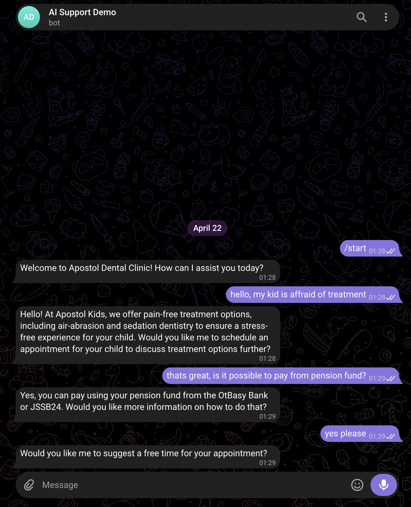
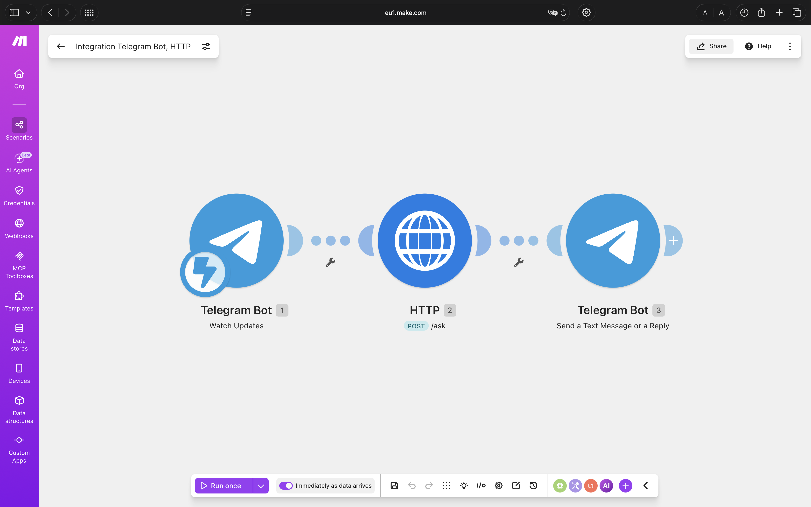

# AI Dental Clinic Agent

An intelligent AI assistant designed specifically for dental clinics. This bot automates patient consultations in Direct/Telegram, answers questions about pricing, treatments, and complex payment procedures (like EPV), and seamlessly hands off to a human administrator when necessary.

**[Watch the Demo Video on Loom](https://www.loom.com/share/3cca72ef58d14165939fc0a1a55c584c)**

---

## Features

* **Context-Aware Responses (RAG):** Uses a ChromaDB vector database to provide accurate answers based *only* on the clinic's real pricing and policies. No hallucinations.
* **Complex Logic Handling:** Perfectly trained to explain multi-step processes, such as using pension funds (EPV) for dental care.
* **Human Handoff:** Automatically recognizes when a user is asking for medical advice or explicitly requesting a human, routing them to a live administrator.
* **Omnichannel Ready:** Core logic is handled via Python/FastAPI, allowing easy integration with Telegram, Instagram, or WhatsApp via Make.com webhooks.

## Interface Preview



---

## Tech Stack

* **Language:** Python 3.10+
* **Framework:** FastAPI (Uvicorn server)
* **AI & Embeddings:** OpenAI API (`gpt-4o-mini`, `text-embedding-3-small`), LangChain
* **Vector Database:** ChromaDB
* **Automation Routing:** Make.com (formerly Integromat)
* **Deployment:** DigitalOcean (Ubuntu VPS) + Ngrok (for local tunneling)

---

## Project Structure

* `api.py` — The main FastAPI application and endpoint (`/chat`) that handles incoming requests.
* `create_database.py` — Script to chunk the markdown data and build the Chroma vector database.
* `query_data.py` — The core RAG logic: searching the database and prompting the OpenAI model.
* `data/books/` — Contains the raw clinic data in Markdown format.
* `requirements.txt` — Python dependencies.

---

## How It Works (Architecture)

1. **User Input:** A patient sends a message in Instagram/Telegram.
2. **Make.com Webhook:** Make catches the message and sends an HTTP POST request to our FastAPI server.
3. **Vector Search:** `query_data.py` calculates the embedding for the user's question and searches ChromaDB for the top 3 most relevant context chunks.
4. **LLM Generation:** The context and the user's question are sent to OpenAI with a strict system prompt to formulate a polite, accurate response.
5. **Response:** The answer is sent back via Make.com to the user's chat.

## End-to-End Request Flow



---

## Local Setup

1. Clone the repository:
   ```bash
   git clone https://github.com/elaygg/ai-dental-clinic-bot.git && cd ai-dental-clinic-bot
